## Agenda

::: {.agenda}
1. [Text, layout & code](#layout) [Cards, callouts, numbers, equations, tables and code]{.agenda-desc}
2. [Images & media](#media) [Full-bleed images, video, embeds and image comparisons]{.agenda-desc}
3. [Diagrams & planning](#diagrams) [Gantt charts, flowcharts and networks]{.agenda-desc}
4. [Scientific plots for ML](#plots) [Interactive figures for papers and talks]{.agenda-desc}
5. [Showing model outputs](#outputs) [Conversations, token attributions and qualitative results]{.agenda-desc}
6. [Presenting](#presenting) [Speaker tools, credits and a closing slide]{.agenda-desc}
:::

::: {.notes}
Each item links to its section: `[Title](#section-id)`, with `{#section-id}` set on the section heading.

Speaker notes live in a `.notes` div. Press **S** to open the speaker view with notes, a timer and a preview of the next slide.
:::

# [01]{.section-num} Text, layout & code {#layout}

[Lists, cards, callouts, numbers, equations, tables and code: the everyday building blocks.]{.section-desc}

## A Simple Incremental List

::: {.incremental .spaced-list style="margin-top: 10%;"}

- **In the U.S.**: an unprecedented 741 AI-related legislative bills were introduced across 30 states by early 2026 [Predictions for 2026: More AI, More Litigation](https://www.esquiresolutions.com/predictions-for-2026-more-ai-more-litigation/)

- **In Europe**: Artificial Intelligence Act (EU AI Act), the Digital Operational Resilience Act (DORA), the General Data Protection Regulation (GDPR), ...

- **Result:** 62% of European organizations are actively seeking sovereign AI architectures, a trend led heavily by the banking sector (76%) and organizations in Germany (73%) and Switzerland (64%). [Europe Seeking Greater AI Sovereignty, Accenture Report Finds](https://newsroom.accenture.com/news/2025/europe-seeking-greater-ai-sovereignty-accenture-report-finds)
:::

##

::: {.center style="margin-top: 10%;"}
<h2 style="font-size: 1.3em; line-height: 1.3;">
  This is a focus slide<br>
  <span class="hl">With a really important message</span>
</h2>
:::

::: {.grid2 .center .mt-1}

::: {.card .plain .green}
[To Be]{.card-title style="border: none; color: var(--green);"}

There are many advantages to being.
:::

::: {.card .plain .orange}
[Or Not To Be]{.card-title style="border: none; color: var(--orange);"}

Would be best for problems not to be.
:::

:::

::: {.center .mt-2 .muted}
Conclusion and take-away message
:::

## {auto-animate="true"}

::: {style="height: 100%; display: flex; flex-direction: column; justify-content: center; align-items: center; text-align: center; font-size: 1em; font-weight: bold;"}
Auto Animate Feature for Smooth Transitions
:::

## {auto-animate="true"}

::: {style="height: 100%; display: flex; flex-direction: column; justify-content: center; align-items: center; text-align: center; font-size: 2em; font-weight: bold;"}
<span class="hl">Auto Animate Feature</span> for Smooth Transitions
:::

## Cards Example

::: {.grid3 .mt-1}

::: {.card .green}
[Card 1 [(This is Card 1)]{.muted}]{.card-title}

Lorem ipsum dolor sit amet, consectetur adipiscing elit. Mauris ipsum turpis, euismod nec turpis eu, posuere ullamcorper lacus.
:::

::: {.card .blue}
[Card 2 [(This is Card 2)]{.muted}]{.card-title}

Curabitur convallis lectus id sapien eleifend, vitae suscipit urna fermentum. Quisque a tortor vitae turpis ullamcorper venenatis. Pellentesque condimentum ornare sem, non elementum quam gravida in.
:::

::: {.card .red}
[Card 3 [(This is Card 3)]{.muted}]{.card-title}

Mauris a fermentum purus. Morbi posuere lorem sit amet finibus blandit. Curabitur lacinia et nisi ac tempor. Quisque eu rhoncus nulla.
:::

:::

::: {.takeaway}
**Takeaway:** a `.takeaway` box closes a slide with the one sentence the audience should remember.
:::

## Callouts

::: {.grid3 .mt-1}

::: {.callout-note title="Definition"}
**Perplexity** is the exponential of the average per-token cross-entropy: lower means the model is less surprised by the text.
:::

::: {.callout-tip title="Tip"}
Mixed-precision training roughly halves activation memory, usually at no cost in accuracy.
:::

::: {.callout-warning title="Caveat"}
Benchmarks that leaked into the pre-training data overstate real-world performance.
:::

:::

::: {.callout-important title="Important" .mt-1}
Report final numbers on a held-out test set; never tune hyperparameters on it.
:::

::: {.notes}
Quarto's built-in callouts: `.callout-note`, `.callout-tip`, `.callout-warning`, `.callout-important` and `.callout-caution`, with the heading set via `title="..."`.
:::

## Stat Tiles with Count-Up

::: {.lead}
Headline numbers count up every time the slide is shown.
:::

::: {.grid4 .mt-2}

::: {.card .stat}
[Benchmark accuracy]{.label}
[[94.2]{.count data-to="94.2" data-decimals="1"}[%]{.unit}]{.value}
[▲ +3.1 pp [vs. baseline]{.muted}]{.delta .up}
[]{.spark data-values="88.1,88.9,89.4,90.2,90.0,91.1,91.8,92.0,92.9,93.1,93.8,94.2"}
:::

::: {.card .stat .green}
[Inference latency (p95)]{.label}
[[182]{.count data-to="182"}[ms]{.unit}]{.value}
[▼ −41% [faster]{.muted}]{.delta .up}
[]{.spark data-values="310,305,298,284,270,262,240,231,214,203,190,182"}
:::

::: {.card .stat .blue}
[Training compute]{.label}
[[1,280]{.count data-to="1280"}[GPU·h]{.unit}]{.value}
[on 8 × H100]{.muted .delta}
[]{.spark data-values="40,130,210,330,420,560,650,760,910,1010,1150,1280"}
:::

::: {.card .stat .red}
[Hallucination rate]{.label}
[[4.7]{.count data-to="4.7" data-decimals="1"}[%]{.unit}]{.value}
[▲ +0.4 pp [needs work]{.muted}]{.delta .down}
[]{.spark data-values="6.1,5.8,5.5,5.2,4.9,4.6,4.4,4.2,4.1,4.3,4.5,4.7"}
:::

:::

::: {.notes}
Markup: `[[94.2]{.count data-to="94.2" data-decimals="1"}[%]{.unit}]{.value}`, sparkline: `[]{.spark data-values="1,3,2,5"}`. The number in the HTML is also the fallback for PDF export.
:::

## Equations, Explained Step by Step

::: {.lead}
Scaled dot-product attention [@vaswani2017attention], the core of every transformer.
:::

$$
\operatorname{Attention}(Q, K, V) = \operatorname{softmax}\!\left(\frac{QK^\top}{\sqrt{d_k}}\right)V
$$

::: {.grid3}

::: {.card .blue .fragment}
[$QK^\top$]{.card-title}

Similarity of every query with every key: one score per token pair.
:::

::: {.card .orange .fragment}
[$\sqrt{d_k}$]{.card-title}

Keeps the logits in a range where softmax still has useful gradients.^[For queries and keys with unit-variance entries, $q \cdot k$ has variance $d_k$.]
:::

::: {.card .green .fragment}
[$\operatorname{softmax}(\cdot)\,V$]{.card-title}

Turns scores into weights and returns a weighted average of the values.
:::

:::

::: {.notes}
Citations come from `references.bib` (`[@key]`) and are listed on the References slide; `^[...]` makes a footnote at the bottom of the slide. Math is written in LaTeX and rendered to MathML at build time, with a bundled font, so it works offline and needs no JavaScript.
:::

## Tabsets for Layered Detail

::: {.panel-tabset}

### PyTorch

```python
for x, y in loader:
    optimizer.zero_grad()
    loss = F.cross_entropy(model(x), y)
    loss.backward()
    optimizer.step()
```

### JAX

```python
@jax.jit
def train_step(state, x, y):
    def loss_fn(params):
        logits = state.apply_fn(params, x)
        return optax.softmax_cross_entropy_with_integer_labels(logits, y).mean()
    grads = jax.grad(loss_fn)(state.params)
    return state.apply_gradients(grads=grads)
```

### Why tabs?

- Keep alternatives on **one** slide without crowding it
- Click a tab live to answer *"how would this look in…?"*
- Works for code, tables, figures or plain text

:::

## Question and Multiple Choice Answer

::: {.grid2 .quiz .mt-1 style="grid-template-columns: 45fr 50fr; gap: 5%;"}

::: {.card .quiz-q style="border-top: 1px solid var(--line); font-size: 1em;"}
[Lorem Ipsum]{.tag}

[Question]{.quiz-label style="color: var(--orange);"}

### Lorem ipsum dolor sit amet, consectetur adipiscing elit.?

[Context]{.quiz-label style="color: var(--blue);"}

[Mauris ipsum turpis, euismod nec turpis eu, posuere ullamcorper lacus. Curabitur convallis lectus id sapien eleifend, vitae suscipit urna fermentum.]{style="font-size: 0.85em; color: #dddddd; line-height: 1.5;"}
:::

::: {.card style="border-top: 1px solid var(--line); font-size: 0.85em;"}
[Options]{.quiz-label .ink style="display: block; margin-bottom: 15px;"}

[[Option A]{.quiz-label} Curabitur convallis]{.option style="display: block;"}
[[Option B]{.quiz-label} Praesent quis]{.option .correct style="display: block;"}
[[Option C]{.quiz-label} Quisque eu rhoncus nulla]{.option style="display: block;"}
[[Option D]{.quiz-label} Quisque a tortor vitae]{.option style="display: block;"}

::: {.explain .fragment}
[Explanation]{.quiz-label}

Praesent quis enim gravida, viverra enim condimentum, accumsan lacus. Suspendisse eu finibus sem, fermentum laoreet nisl.
:::
:::

:::

## Results Table

::: {.lead}
Accuracy (%) on MMLU [@hendrycks2021mmlu], GSM8K [@cobbe2021gsm8k], HumanEval [@chen2021codex] and ARC-Challenge [@clark2018arc].
:::

::: {.compact-table .results-table}
| Method | MMLU | GSM8K | HumanEval | ARC-C | Avg. |
| :--- | ---: | ---: | ---: | ---: | ---: |
| Baseline 7B | 61.2 [±0.7]{.pm} | 48.5 [±1.5]{.pm} | 33.1 [±1.9]{.pm} | 72.4 [±0.9]{.pm} | 53.8 |
| + Retrieval | [66.0]{.second} [±0.6]{.pm} | 51.2 [±1.3]{.pm} | 35.4 [±2.1]{.pm} | [76.9]{.second} [±0.8]{.pm} | 57.4 |
| + Chain-of-thought | 64.1 [±0.8]{.pm} | [56.9]{.second} [±1.4]{.pm} | [38.2]{.second} [±1.8]{.pm} | 74.8 [±1.0]{.pm} | [58.5]{.second} |
| + Self-reflection [ours]{.ours} | **69.4** [±0.5]{.pm} | **60.3** [±1.2]{.pm} | **44.8** [±1.7]{.pm} | **80.1** [±0.7]{.pm} | **63.7** |
:::

::: aside
Mean ± std over 5 seeds · **bold**: best · [underlined]{.second}: second best · synthetic numbers
:::

::: {.notes}
A plain Markdown table: mark the best value with `**69.4**` and the runner-up with `[66.0]{.second}`. The row containing `[ours]{.ours}` is highlighted automatically. `::: aside` puts a note at the bottom of the slide.
:::

## Code Highlighting & Multicolumn

:::: {.columns style="margin-top: 5%;"}

::: {.column width="50%"}

```Dockerfile {code-line-numbers="18-26|6-16"}
# syntax=docker/dockerfile:1.4

# ---- STAGE 1: Builder --------------------------------
FROM python:3.12-slim-bookworm AS builder

COPY pyproject.toml uv.lock ./

# Export requirements text locally
RUN uv export --frozen --no-dev --group training \
--group gaudi --no-hashes --no-emit-project \
--format requirements-txt > requirements.txt

# Filter out hardware-specific packages to protect the
# base image binaries
RUN grep -vE '^(torch|torchvision|torchaudio|vllm|nvidia|triton)' \
requirements.txt > requirements.final.txt

# ---- STAGE 2: Production ------------------------------
# Base Image MUST match driver version (see hl-smi)
FROM vault.habana.ai/gaudi-docker/1.23.0/ubuntu22.04\
     /habanalabs/pytorch-installer-2.9.0:latest

RUN uv pip install --no-deps -r requirements.final.txt

# Expect application code to be mounted at runtime.
CMD ["/bin/bash"]


```

:::

::: {.column width="50%"}

```bash {.number-lines}
#!/bin/bash
...
IMAGE_NAME="$1"

docker run -it --rm \
  --runtime=habana \
  --privileged \
  --cap-add=sys_nice \
  --cap-add=IPC_LOCK \
  --ipc=host \
  --net=host \
  --ulimit memlock=-1:-1 \
  --ulimit stack=67108864 \
  -e HABANA_VISIBLE_DEVICES=$DEVICE_ID \
  -e PT_HPU_ENABLE_CPU_FALLBACK_LOGGING=1 \
  -e DDP_SHARED_ID=$RANDOM \
  -v "$PROJECT_ROOT":/workspace \
  -v ~/.cache/huggingface:/workspace/cache \
  "$IMAGE_NAME" \
  "$@"

```

:::

::::

# [02]{.section-num} Images & media {#media}

[Full-bleed images, video, embedded web content and interactive image comparisons.]{.section-desc}

## {background-image="assets/logowall.png" background-size="contain" data-state="hide-ui"}

::: {.absolute bottom="50%" right="45%" style="font-size: 0.5em; color: #ffffff; background-color: rgba(0,0,0,0.5); padding: 5px 10px; border-radius: 5px;"}
Full slide image
:::

## Embedded Image {style="--frame: #fffdf9"}

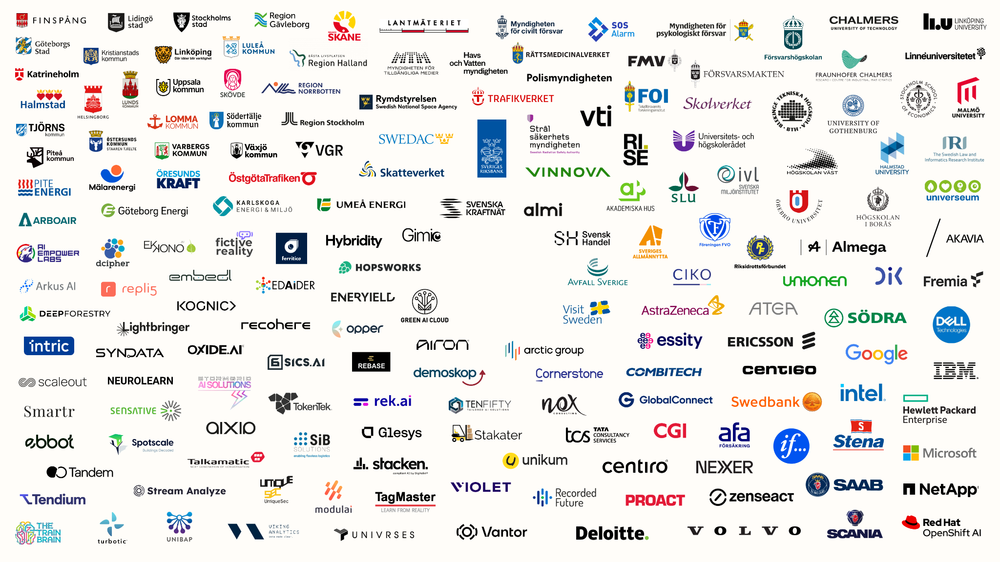{.framed fig-alt="Wall of about 200 partner logos on a white background"}

::: {.notes}
`.framed` puts the image on a white card with rounded corners and a soft shadow, so figures with a white background (plots, diagrams, logos) don't end in hard edges against the dark slide. Its height is capped relative to the canvas, so it also fits in portrait. The caption is optional: `{.framed}`; leave the brackets empty for none. The frame is white by default; this image has a slightly warm background, so `style="--frame: #fffdf9"` on the slide heading matches it to avoid a visible seam.
:::

## {background-iframe="https://www.youtube.com/embed/Vpu3vou0cRE?autoplay=1&controls=0&rel=0" background-interactive="true"}

## Embedding IFrames {background-color="#FCFBFA"}

```{=html}
<div class="iframe-row">
  <iframe src="https://datawrapper.dwcdn.net/wQR5S" scrolling="no"></iframe>
  <iframe src="https://datawrapper.dwcdn.net/jWDre" scrolling="no"></iframe>
  <iframe src="https://datawrapper.dwcdn.net/hOCCz" scrolling="no"></iframe>
</div>
```

## Local Video

::: {.grid-2-1}

```{=html}
<figure class="video-frame">
  <video data-autoplay loop muted playsinline>
    <source src="assets/demo.webm" type="video/webm">
    <source src="assets/demo.mp4" type="video/mp4">
  </video>
</figure>
```

::: {}
[Demo recording]{.kicker}

Bundled with the deck, so it plays offline: no YouTube, no conference Wi-Fi.

::: {.lead .small .mt-1}
Starts when the slide opens, pauses when you leave and loops silently. Ship WebM plus an MP4 fallback for Safari.
:::
:::

:::

::: {.notes}
`data-autoplay` makes Reveal play the video when the slide is shown. For a full-bleed version use `## {background-video="assets/demo.mp4" background-video-loop="true" background-video-muted="true"}`.
:::

## Before / After Comparison

::: {.grid-2-1 .mt-1}

```{=html}
<div>
  
    
    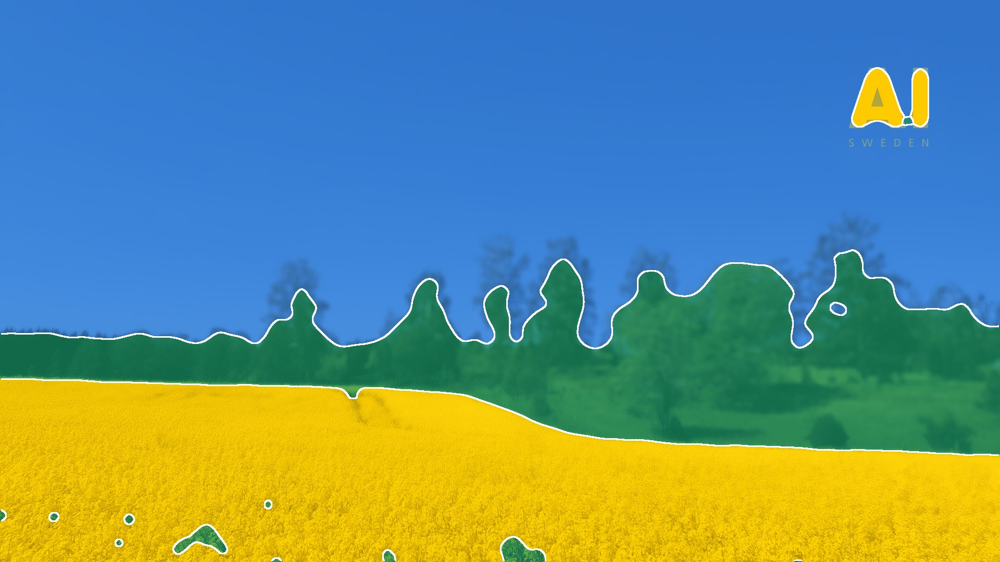
  </img-comparison-slider>
  <div class="compare-labels"><span>Input</span><span>Model output</span></div>
</div>
```

::: {}
[Semantic segmentation]{.kicker}

Drag the handle to compare the input with the predicted mask.

::: {.legend .mt-1 style="flex-direction: column; gap: 18px; font-size: 0.7em;"}
[Sky]{style="--c: #3987e5"}
[Vegetation]{style="--c: #199e70"}
[Crop field]{style="--c: #FECB00"}
:::

::: {.lead .mt-1 .small}
Works for any pair of same-sized images: raw vs. denoised, ground truth vs. prediction, v1 vs. v2.
:::
:::

:::

## Manual Logo Wall

::: {.logo-wall}
{style="transform: translateX(-20px);"}


[]{.break}


:::

## Images synchronized to list items

::::: {.columns}

:::: {.column width="50%"}

:::: {style="margin-top: 10%;"}

<ul class="spaced-list">

  <li class="fragment" data-fragment-index="0">
    First point in list: White AI.SE logo
  </li>
  <br>
  <li class="fragment" data-fragment-index="1">
    Second point in list: Gold AI.SE logo
  </li>
</ul>

::::

::::


:::: {.column width="50%"}

<div class="r-stack" style="width: 100%; margin-top: 10%;">

  

  
</div>

::::

:::::

# [03]{.section-num} Diagrams & planning {#diagrams}

[Gantt charts, flowcharts and networks, written as text and drawn in the browser.]{.section-desc}

## Gantt Chart

```{mermaid}
%%| echo: false
---
config:
  themeVariables:
    taskTextDarkColor: "#ffffff"
    taskTextOutsideColor: "#ffffff"
  gantt:
    barHeight: 46
    barGap: 12
    fontSize: 20
    sectionFontSize: 22
    topPadding: 70
    leftPadding: 230
    gridLineStartPadding: 50
    useWidth: 1800
    axisFormat: "%b %Y"
    tickInterval: 1month
---
gantt
    dateFormat YYYY-MM-DD
    section Data
    Collection & licensing   :done, d1, 2026-06-01, 60d
    Cleaning & dedup         :done, d2, after d1, 35d
    section Modelling
    Pre-training             :active, m1, 2026-08-15, 110d
    Fine-tuning              :m2, after m1, 40d
    section Evaluation
    Benchmark suite          :active, e1, 2026-09-15, 80d
    Red-teaming              :crit, e2, after m2, 30d
    section Release
    Paper submission         :milestone, r1, 2027-02-15, 0d
    Public release           :milestone, r2, 2027-03-20, 0d
```

::: {.chart-note}
Grey = done · yellow = in progress · red = critical · vertical line = today
:::

::: {.notes}
Mermaid diagrams are plain text inside a `{mermaid}` code block; colours come from `style.css`. Statuses: `done`, `active`, `crit`, `milestone`.
:::

## Flowchart

```{mermaid}
%%| echo: false
---
config:
  htmlLabels: false
  themeVariables:
    fontSize: 30px
    fontFamily: '"Office Sans", "Helvetica Neue", Helvetica, Arial, sans-serif'
  flowchart:
    nodeSpacing: 60
    rankSpacing: 70
---
flowchart LR
    A[(Raw data)] --> B[Clean & dedupe]
    B --> C[Tokenize]
    C --> D[Pre-train]
    D --> E[Fine-tune]
    E --> F{Eval gate}
    F -- pass --> G([Deploy])
    F -- fail --> E
    G --> H[Monitor]
    H -. drift .-> A
    classDef accent stroke-width:3px
    class D accent
```

::: {.takeaway}
Add `class <node> accent` to highlight the step you are talking about.
:::

## Network Graph

::: {.grid-1-2}

::: {}
[Knowledge graph]{.kicker}

[Hover a node to trace its neighbours; drag nodes to rearrange the layout.]{.lead}

::: {.legend .mt-1 style="flex-direction: column; gap: 18px; font-size: 0.65em;"}
[Model]{style="--c: var(--series-1)"}
[Data]{style="--c: var(--series-2)"}
[Orchestration]{style="--c: var(--series-3)"}
:::
:::

```{=html}
<div id="chart-network" class="chart tall"></div>
<script>
Deck.chart("chart-network", (el) => {
  const c = Deck.colors, W = el.clientWidth, H = el.clientHeight;
  const groups = { Model: 0, Data: 1, Orchestration: 2 };
  const nodes = [
    ["LLM", "Model"], ["Embedding model", "Model"], ["Reranker", "Model"], ["Guardrails", "Model"], ["Fine-tuning", "Model"],
    ["Documents", "Data"], ["Chunking", "Data"], ["Vector DB", "Data"], ["Knowledge graph", "Data"], ["Metadata", "Data"], ["Feedback logs", "Data"],
    ["Agent", "Orchestration"], ["Planner", "Orchestration"], ["Tools", "Orchestration"], ["Memory", "Orchestration"],
    ["Prompt templates", "Orchestration"], ["Evaluator", "Orchestration"], ["Router", "Orchestration"],
  ].map(([id, g]) => ({ id, group: groups[g] }));
  const links = [
    ["Documents", "Chunking"], ["Chunking", "Embedding model"], ["Embedding model", "Vector DB"], ["Vector DB", "Reranker"],
    ["Reranker", "LLM"], ["Documents", "Metadata"], ["Metadata", "Vector DB"], ["Documents", "Knowledge graph"],
    ["Knowledge graph", "Agent"], ["Agent", "Planner"], ["Planner", "Tools"], ["Agent", "Memory"], ["Agent", "LLM"],
    ["Prompt templates", "LLM"], ["Router", "Agent"], ["Router", "LLM"], ["LLM", "Guardrails"], ["Evaluator", "LLM"],
    ["Evaluator", "Feedback logs"], ["Feedback logs", "Fine-tuning"], ["Fine-tuning", "LLM"], ["Tools", "Vector DB"],
    ["Memory", "Vector DB"], ["Planner", "LLM"],
  ].map(([source, target]) => ({ source, target }));

  const degree = {};
  links.forEach((l) => { degree[l.source] = (degree[l.source] || 0) + 1; degree[l.target] = (degree[l.target] || 0) + 1; });
  const radius = (d) => 12 + 4 * degree[d.id];

  // Fixed viewBox, so the graph scales with its container when the canvas is resized
  const svg = d3.select(el).append("svg").attr("class", "net").attr("viewBox", [0, 0, W, H]).style("width", "100%").style("height", "100%");
  const sim = d3.forceSimulation(nodes)
    .force("link", d3.forceLink(links).id((d) => d.id).distance(150))
    .force("charge", d3.forceManyBody().strength(-1800))
    .force("collide", d3.forceCollide((d) => radius(d) + 44))
    .force("x", d3.forceX(W / 2).strength(0.04))
    .force("y", d3.forceY(H / 2).strength(0.03));

  const link = svg.append("g").selectAll("line").data(links).join("line").attr("stroke-width", 2.5);
  const node = svg.append("g").selectAll("circle").data(nodes).join("circle")
    .attr("r", radius).attr("fill", (d) => c.series[d.group]);
  const label = svg.append("g").selectAll("text").data(nodes).join("text")
    .text((d) => d.id).attr("text-anchor", "middle");

  node.call(d3.drag()
    .on("start", (e, d) => { if (!e.active) sim.alphaTarget(0.3).restart(); d.fx = d.x; d.fy = d.y; })
    .on("drag", (e, d) => { d.fx = e.x; d.fy = e.y; })
    .on("end", (e, d) => { if (!e.active) sim.alphaTarget(0); d.fx = null; d.fy = null; }));

  node.on("pointerenter", (e, d) => {
    const near = new Set([d.id]);
    links.forEach((l) => { if (l.source.id === d.id) near.add(l.target.id); if (l.target.id === d.id) near.add(l.source.id); });
    svg.classed("focus", true);
    node.classed("lit", (n) => near.has(n.id));
    label.classed("lit", (n) => near.has(n.id));
    link.classed("lit", (l) => l.source.id === d.id || l.target.id === d.id);
  }).on("pointerleave", () => svg.classed("focus", false));

  sim.on("tick", () => {
    for (const d of nodes) {
      const r = radius(d) + 4;
      d.x = Math.max(r + 80, Math.min(W - r - 80, d.x));
      d.y = Math.max(r + 40, Math.min(H - r - 10, d.y));
    }
    link.attr("x1", (l) => l.source.x).attr("y1", (l) => l.source.y).attr("x2", (l) => l.target.x).attr("y2", (l) => l.target.y);
    node.attr("cx", (d) => d.x).attr("cy", (d) => d.y);
    label.attr("x", (d) => d.x).attr("y", (d) => d.y - radius(d) - 12);
  });
});
</script>
```

:::

# [04]{.section-num} Scientific plots for ML {#plots}

[The figures ML papers and talks rely on, interactive: hover for values, drag to zoom, double-click to reset, camera icon for an SVG.]{.section-desc}

## Training Curves

```{=html}
<div id="chart-training" class="chart"></div>
<div class="chart-note">Mean ± 1 std over 5 seeds · synthetic data</div>
<script>
Deck.chart("chart-training", (el) => {
  const c = Deck.colors, rng = Deck.rng(7);
  const steps = Array.from({ length: 121 }, (_, i) => i * 500);
  const runs = (a, b, k, drift, noise) => Array.from({ length: 5 }, () =>
    steps.map((t) => a + b * Math.exp(-t / k) + drift * Math.max(0, t - 32000) / 28000 + rng.normal(0, noise) * (1 + 3 * Math.exp(-t / 6000))));
  const band = (rs) => steps.map((_, i) => {
    const v = rs.map((r) => r[i]), m = v.reduce((s, x) => s + x, 0) / v.length;
    return [m, Math.sqrt(v.reduce((s, x) => s + (x - m) ** 2, 0) / v.length)];
  });
  const series = [
    { name: "Train", color: c.series[0], stats: band(runs(1.48, 2.7, 7000, 0, 0.018)) },
    { name: "Validation", color: c.series[1], stats: band(runs(1.70, 2.5, 7500, 0.14, 0.03)) },
  ];
  const traces = series.flatMap((s) => [
    { x: steps, y: s.stats.map(([m, sd]) => m + sd), mode: "lines", line: { width: 0 }, hoverinfo: "skip", showlegend: false },
    { x: steps, y: s.stats.map(([m, sd]) => m - sd), mode: "lines", line: { width: 0 }, fill: "tonexty",
      fillcolor: Deck.alpha(s.color, 0.16), hoverinfo: "skip", showlegend: false },
    { x: steps, y: s.stats.map(([m]) => m), mode: "lines", name: s.name, line: { color: s.color, width: 3.5 },
      hovertemplate: "<b>%{y:.3f}</b><extra>" + s.name + "</extra>" },
  ]);
  const val = series[1].stats.map(([m]) => m);
  const best = val.indexOf(Math.min(...val));
  traces.push({ x: [steps[best]], y: [val[best]], mode: "markers", showlegend: false, hoverinfo: "skip",
    marker: { size: 18, color: c.accent, line: { color: c.surface, width: 3 } } });
  Plotly.newPlot(el, traces, Deck.layout({
    hovermode: "x unified",
    legend: { traceorder: "normal" },
    xaxis: { title: { text: "Training step" }, tickformat: "~s", range: [0, 60000] },
    yaxis: { title: { text: "Cross-entropy loss" }, range: [1.3, 4.6] },
    annotations: [{ x: steps[best], y: val[best], ax: 0, ay: -90, text: `<b>Best checkpoint</b><br>step ${(steps[best] / 1000).toFixed(1)}k · loss ${val[best].toFixed(3)}`,
      font: { color: c.ink, size: 22 }, arrowcolor: c.accent, arrowwidth: 2, arrowhead: 0 }],
  }), Deck.config);
});
</script>
```

## Benchmark Comparison, Step by Step

::: {.grid-2-1}

```{=html}
<div id="chart-bench" class="chart"></div>
<script>
Deck.steps("chart-bench", {
  init(el) {
    el.models = [
      { name: "Baseline 7B", y: [61.2, 48.5, 33.1, 72.4], e: [0.7, 1.5, 1.9, 0.9] },
      { name: "+ Retrieval", y: [66.0, 51.2, 35.4, 76.9], e: [0.6, 1.3, 2.1, 0.8] },
      { name: "+ Self-reflection (ours)", y: [69.4, 60.3, 44.8, 80.1], e: [0.5, 1.2, 1.7, 0.7] },
    ];
    el.render = (i, animate) => {
      const c = Deck.colors, bench = ["MMLU", "GSM8K", "HumanEval", "ARC-C"];
      const traces = el.models.map((m, k) => {
        const on = k === 0 || i >= k - 1;
        const dim = i >= 2 && k < 2;
        return {
          type: "bar", name: m.name, x: bench, y: on ? m.y : m.y.map(() => 0), showlegend: on,
          marker: { color: c.series[k], opacity: dim ? 0.3 : 1 },
          error_y: { type: "data", array: m.e, visible: on, color: dim ? "rgba(255,255,255,0.2)" : "rgba(255,255,255,0.6)", thickness: 2, width: 8 },
          hovertemplate: "<b>%{y:.1f}%</b> ± %{error_y.array:.1f}<extra>" + m.name + "</extra>",
        };
      });
      const ours = el.models[2], base = el.models[0];
      const annotations = i < 2 ? [] : ours.y.map((v, j) => ({
        // Grouped bars: 3 slots of (1 - bargap) / 3 per category; ours is the right-hand slot
        x: j + (1 - 0.22) / 3, y: v + ours.e[j] + 1.5, yanchor: "bottom", showarrow: false,
        text: `<b>+${(v - base.y[j]).toFixed(1)}</b>`, font: { size: 24, color: c.ink },
      }));
      const layout = Deck.layout({
        barmode: "group", bargap: 0.22, bargroupgap: 0.08, barcornerradius: 4, hovermode: "closest",
        yaxis: { title: { text: "Accuracy (%)" }, range: [0, 100] },
        xaxis: { tickfont: { size: 24, color: c.body } },
        annotations,
        transition: animate ? { duration: 650, easing: "cubic-in-out" } : undefined,
      });
      Plotly.react(el, traces, layout, Deck.config);
    };
    el.render(-1, false);
  },
  step(el, i) { el.render(i, true); },
});
</script>
```

```{=html}
<ul class="chart-steps">
  <li><strong>Baseline</strong>7B instruction-tuned model.</li>
  <li class="fragment"><strong>+ Retrieval</strong>Top-5 passages from the document store.</li>
  <li class="fragment"><strong>+ Self-reflection (ours)</strong>The model critiques and revises its draft.</li>
  <li class="fragment"><strong>Gains vs. baseline</strong>Largest on reasoning-heavy GSM8K and HumanEval.</li>
</ul>
```

:::

::: {.notes}
`Deck.steps()` re-renders the chart whenever a fragment is shown or hidden, so stepping backwards works too.
:::

## Distributions: Violin, Box & Points

```{=html}
<div id="chart-violin" class="chart"></div>
<div class="chart-note">Accuracy on each of 57 MMLU subjects · hover a point for the subject · synthetic data</div>
<script>
Deck.chart("chart-violin", (el) => {
  const c = Deck.colors, rng = Deck.rng(3);
  const subjects = ("abstract algebra,anatomy,astronomy,business ethics,clinical knowledge,college biology,college chemistry,college computer science,college mathematics,college medicine,college physics,computer security,conceptual physics,econometrics,electrical engineering,elementary mathematics,formal logic,global facts,high school biology,high school chemistry,high school computer science,high school european history,high school geography,high school government,high school macroeconomics,high school mathematics,high school microeconomics,high school physics,high school psychology,high school statistics,high school us history,high school world history,human aging,human sexuality,international law,jurisprudence,logical fallacies,machine learning,management,marketing,medical genetics,miscellaneous,moral disputes,moral scenarios,nutrition,philosophy,prehistory,professional accounting,professional law,professional medicine,professional psychology,public relations,security studies,sociology,us foreign policy,virology,world religions").split(",");
  const difficulty = subjects.map(() => rng.normal(0, 9));
  const models = [["Baseline 7B", 61, 4], ["+ Retrieval", 66, 3.5], ["+ Self-reflection (ours)", 69.5, 3]];
  const traces = models.map(([name, mu, noise], k) => ({
    type: "violin", name, x0: name, text: subjects,
    y: difficulty.map((d) => Math.max(25, Math.min(97, mu + d * (1 - 0.08 * k) + rng.normal(0, noise)))),
    line: { color: c.series[k], width: 2.5 }, fillcolor: Deck.alpha(c.series[k], 0.16),
    box: { visible: true, width: 0.1, fillcolor: "rgba(255,255,255,0.10)", line: { color: "rgba(255,255,255,0.7)", width: 2 } },
    meanline: { visible: true, color: c.ink, width: 2 },
    points: "all", jitter: 0.45, pointpos: 0, spanmode: "hard",
    marker: { size: 9, color: c.series[k], opacity: 0.85, line: { color: c.surface, width: 1.5 } },
    hoveron: "points", hovertemplate: "%{text}<br><b>%{y:.1f}%</b><extra>" + name + "</extra>",
  }));
  Plotly.newPlot(el, traces, Deck.layout({
    showlegend: false, violingap: 0.25,
    xaxis: { tickfont: { size: 24, color: c.body }, showline: false },
    yaxis: { title: { text: "Subject accuracy (%)" }, range: [20, 100] },
  }), Deck.config);
});
</script>
```

## Quantiles: Latency ECDF

::: {.grid-2-1}

```{=html}
<div id="chart-ecdf" class="chart"></div>
<script>
Deck.chart("chart-ecdf", (el) => {
  const c = Deck.colors, rng = Deck.rng(11), n = 4000;
  const configs = [["FP16", 230, 0.30], ["INT8", 160, 0.33], ["INT4 + speculative", 95, 0.52]];
  const q = (xs, p) => xs[Math.min(xs.length - 1, Math.floor(p * xs.length))];
  const rows = [];
  const traces = configs.map(([name, median, sigma], k) => {
    const xs = Array.from({ length: n }, () => median * Math.exp(rng.normal(0, sigma))).sort((a, b) => a - b);
    rows.push([name, k, q(xs, 0.5), q(xs, 0.95), q(xs, 0.99)]);
    const idx = Array.from({ length: 400 }, (_, i) => Math.floor((i / 399) * (n - 1)));
    return { x: idx.map((i) => xs[i]), y: idx.map((i) => (i + 1) / n), name, mode: "lines", line: { color: c.series[k], width: 3.5, shape: "hv" },
      hovertemplate: "p%{customdata:.1f} · <b>%{x:.0f} ms</b><extra>" + name + "</extra>", customdata: idx.map((i) => (100 * (i + 1)) / n) };
  });
  const refs = [[0.5, "p50"], [0.95, "p95"], [0.99, "p99"]];
  Plotly.newPlot(el, traces, Deck.layout({
    xaxis: { type: "log", title: { text: "Request latency (ms, log scale)" }, tickvals: [30, 50, 100, 200, 500, 1000], range: [Math.log10(25), Math.log10(1400)] },
    yaxis: { title: { text: "Fraction of requests ≤ x" }, range: [0, 1.02], tickformat: ".0%" },
    shapes: refs.map(([y]) => ({ type: "line", xref: "paper", x0: 0, x1: 1, y0: y, y1: y, line: { color: c.axis, width: 1 } })),
    annotations: refs.map(([y, t]) => ({ xref: "paper", x: 0.005, y, text: t, showarrow: false, xanchor: "left", yanchor: t === "p95" ? "top" : "bottom", font: { size: 18, color: c.muted } })),
  }), Deck.config);

  const table = document.getElementById("ecdf-table");
  for (const [name, k, p50, p95, p99] of rows) {
    const tr = table.insertRow();
    const key = tr.insertCell();
    const dot = document.createElement("span");
    dot.style.cssText = `display:inline-block;width:16px;height:16px;border-radius:50%;margin-right:12px;background:${c.series[k]}`;
    key.append(dot, document.createTextNode(name));
    for (const v of [p50, p95, p99]) tr.insertCell().textContent = Math.round(v);
  }
});
</script>
```

::: {}
[Latency quantiles (ms)]{.kicker}

::: {.compact-table}
```{=html}
<table id="ecdf-table" style="font-variant-numeric: tabular-nums;">
  <thead><tr><th>Config</th><th>p50</th><th>p95</th><th>p99</th></tr></thead>
</table>
```
:::

::: {.lead .small .mt-1}
Quantization moves the whole curve left; speculative decoding has the best median but a longer tail.
:::
:::

:::

## Confusion Matrix

::: {.grid-2-1 style="grid-template-columns: 1.15fr 1fr;"}

```{=html}
<div id="chart-confusion" class="chart tall"></div>
<script>
Deck.chart("chart-confusion", (el) => {
  const c = Deck.colors;
  const labels = ["plane", "car", "bird", "cat", "deer", "dog"];
  const counts = [
    [921, 18, 27, 9, 11, 14], [12, 958, 4, 8, 3, 15], [38, 3, 846, 41, 47, 25],
    [9, 7, 39, 768, 35, 142], [7, 2, 44, 36, 877, 34], [5, 4, 27, 118, 31, 815],
  ];
  const pct = counts.map((row) => row.map((v) => (100 * v) / row.reduce((s, x) => s + x, 0)));
  const annotations = pct.flatMap((row, i) => row.map((v, j) => ({
    x: labels[j], y: labels[i], text: v < 1 ? v.toFixed(1) : v.toFixed(0), showarrow: false,
    font: { size: 22, color: v > 45 ? "#121F2B" : v > 3 ? "#ffffff" : c.muted, weight: i === j ? 700 : 400 },
  })));
  Plotly.newPlot(el, [{
    type: "heatmap", x: labels, y: labels, z: pct, customdata: counts, xgap: 3, ygap: 3, zmin: 0, zmax: 100,
    colorscale: [[0, "#16283a"], [0.04, "#184f95"], [0.2, "#2a78d6"], [0.6, "#86b6ef"], [1, "#cde2fb"]],
    colorbar: { thickness: 14, outlinewidth: 0, ticksuffix: "%", tickfont: { size: 18, color: c.muted }, len: 0.9 },
    hovertemplate: "true <b>%{y}</b> → predicted <b>%{x}</b><br><b>%{z:.1f}%</b> (%{customdata} images)<extra></extra>",
  }], Deck.layout({
    annotations,
    xaxis: { title: { text: "Predicted label" }, showline: false, showgrid: false, tickfont: { size: 22, color: c.body }, constrain: "domain" },
    yaxis: { title: { text: "True label" }, autorange: "reversed", showline: false, showgrid: false, tickfont: { size: 22, color: c.body }, scaleanchor: "x", constrain: "domain" },
  }), Deck.config);
});
</script>
```

::: {}
::: {.card .stat}
[Top-1 accuracy]{.label}
[86.4[%]{.unit}]{.value}
:::

::: {.card .stat .orange .mt-1}
[cat ↔ dog confusions]{.label}
[32[% of errors]{.unit}]{.value}
:::

::: {.lead .small .mt-1}
Rows are normalised per true class; the diagonal is per-class recall.
:::
:::

:::

## ROC & Precision–Recall Curves

```{=html}
<div id="chart-roc" class="chart"></div>
<div class="chart-note">Binormal score model, 15% positives · synthetic data</div>
<script>
Deck.chart("chart-roc", (el) => {
  const c = Deck.colors, prev = 0.15;
  const erf = (x) => { const t = 1 / (1 + 0.3275911 * Math.abs(x)); const y = 1 - (((((1.061405429 * t - 1.453152027) * t) + 1.421413741) * t - 0.284496736) * t + 0.254829592) * t * Math.exp(-x * x); return x >= 0 ? y : -y; };
  const Phi = (z) => 0.5 * (1 + erf(z / Math.SQRT2));
  const zs = Array.from({ length: 241 }, (_, i) => 4 - i / 30);
  const models = [["Baseline 7B", 1.5], ["+ Retrieval", 1.95], ["+ Self-reflection (ours)", 2.55]];
  const traces = [];
  models.forEach(([name, d], k) => {
    const fpr = zs.map((z) => 1 - Phi(z)), tpr = zs.map((z) => 1 - Phi(z - d));
    const prec = fpr.map((f, i) => (tpr[i] * prev) / (tpr[i] * prev + f * (1 - prev) || 1));
    let auc = 0, ap = 0;
    for (let i = 1; i < zs.length; i++) { auc += (fpr[i] - fpr[i - 1]) * (tpr[i] + tpr[i - 1]) / 2; ap += (tpr[i] - tpr[i - 1]) * prec[i]; }
    const line = { color: c.series[k], width: 3.5 };
    traces.push({ x: fpr, y: tpr, name: `${name} · AUC ${auc.toFixed(2)} · AP ${ap.toFixed(2)}`, legendgroup: name, mode: "lines", line,
      hovertemplate: "FPR %{x:.2f} · <b>TPR %{y:.2f}</b><extra>" + name + "</extra>" });
    traces.push({ x: tpr.slice(1), y: prec.slice(1), xaxis: "x2", yaxis: "y2", legendgroup: name, showlegend: false, mode: "lines", line,
      hovertemplate: "recall %{x:.2f} · <b>precision %{y:.2f}</b><extra>" + name + "</extra>" });
  });
  const ref = { color: c.muted, width: 1.5, dash: "dot" };
  traces.push({ x: [0, 1], y: [0, 1], mode: "lines", line: ref, hoverinfo: "skip", showlegend: false });
  traces.push({ x: [0, 1], y: [prev, prev], xaxis: "x2", yaxis: "y2", mode: "lines", line: ref, hoverinfo: "skip", showlegend: false });
  const unit = { range: [0, 1.01], tickvals: [0, 0.25, 0.5, 0.75, 1], constrain: "domain" };
  Plotly.newPlot(el, traces, Deck.layout({
    legend: { y: 1.04 },
    xaxis: { ...unit, domain: [0, 0.45], title: { text: "False positive rate" } },
    yaxis: { ...unit, title: { text: "True positive rate" }, scaleanchor: "x" },
    xaxis2: { ...unit, domain: [0.55, 1], title: { text: "Recall" }, anchor: "y2" },
    yaxis2: { ...unit, title: { text: "Precision" }, anchor: "x2", scaleanchor: "x2" },
    annotations: [
      { xref: "x", yref: "y", x: 0.62, y: 0.55, text: "chance", showarrow: false, textangle: -40, font: { size: 18, color: c.muted } },
      { xref: "x2", yref: "y2", x: 0.98, y: prev, text: "chance", showarrow: false, xanchor: "right", yanchor: "bottom", font: { size: 18, color: c.muted } },
    ],
  }), Deck.config);
});
</script>
```

## Embedding Space in 3D

::: {.grid-2-1 style="grid-template-columns: 2.2fr 1fr;"}

```{=html}
<div id="chart-embed" class="chart tall"></div>
<script>
Deck.chart("chart-embed", (el) => {
  const c = Deck.colors, rng = Deck.rng(5);
  const clusters = [["Legal", [2.4, -0.4, -0.6]], ["Medical", [-1.6, 2.2, 0.4]], ["Finance", [-1.2, -2.0, 1.6]]];
  const traces = clusters.map(([name, [cx, cy, cz]], k) => {
    const n = 260, pts = { x: [], y: [], z: [], text: [] };
    for (let i = 0; i < n; i++) {
      pts.x.push(cx + rng.normal(0, 0.55)); pts.y.push(cy + rng.normal(0, 0.55)); pts.z.push(cz + rng.normal(0, 0.55));
      pts.text.push(`${name.toLowerCase()}-doc-${String(i + 1).padStart(3, "0")}`);
    }
    return { type: "scatter3d", mode: "markers", name, ...pts, marker: { size: 5.5, color: c.series[k], opacity: 0.9 },
      hovertemplate: "<b>%{text}</b><extra>" + name + "</extra>" };
  });
  const ax = { showbackground: false, gridcolor: c.grid, zerolinecolor: c.axis, showspikes: false, title: { text: "" },
    tickfont: { size: 14, color: c.muted }, showticklabels: false };
  Plotly.newPlot(el, traces, Deck.layout({
    legend: { y: 0.98, yanchor: "top", itemsizing: "constant" },
    scene: { xaxis: ax, yaxis: ax, zaxis: ax, aspectmode: "cube", domain: { x: [0, 1], y: [0, 1] }, camera: { eye: { x: 1.2, y: 1.2, z: 0.7 } } },
  }), Deck.config);

  // Slow turntable rotation until the audience grabs the plot
  let angle = Math.PI / 4, spinning = true;
  el.addEventListener("pointerdown", () => (spinning = false));
  const spin = () => {
    if (!spinning || !document.body.contains(el)) return;
    if (el.closest("section.present")) {
      angle += 0.004;
      Plotly.relayout(el, { "scene.camera.eye": { x: 1.7 * Math.cos(angle), y: 1.7 * Math.sin(angle), z: 0.7 } });
    }
    setTimeout(() => requestAnimationFrame(spin), 40);
  };
  spin();
});
</script>
```

::: {}
[UMAP of document embeddings]{.kicker}

[Drag to rotate, scroll to zoom, hover a point to see the document.]{.lead}

::: {.takeaway .small}
Three domains separate cleanly: a domain classifier on these embeddings should be easy.
:::
:::

:::

## Scaling Laws

```{=html}
<div id="chart-scaling" class="chart"></div>
<script>
Deck.chart("chart-scaling", (el) => {
  const c = Deck.colors, rng = Deck.rng(21);
  const budgets = [1e18, 3e18, 1e19, 3e19, 1e20, 3e20, 1e21, 3e21, 1e22];
  const families = [["Dense", 26, 0.05], ["Mixture-of-experts", 24, 0.052]];
  const traces = [], annotations = [];
  families.forEach(([name, A, alpha], k) => {
    const y = budgets.map((C) => A * Math.pow(C, -alpha) * Math.exp(rng.normal(0, 0.012)));
    // Least-squares fit of log L = log a - b log C
    const lx = budgets.map(Math.log10), ly = y.map(Math.log10), n = lx.length;
    const mx = lx.reduce((s, v) => s + v, 0) / n, my = ly.reduce((s, v) => s + v, 0) / n;
    const b = lx.reduce((s, v, i) => s + (v - mx) * (ly[i] - my), 0) / lx.reduce((s, v) => s + (v - mx) ** 2, 0);
    const fit = (C) => Math.pow(10, my + b * (Math.log10(C) - mx));
    const color = c.series[k];
    traces.push({ x: budgets, y, name, mode: "markers", marker: { size: 16, color, line: { color: c.surface, width: 2.5 } },
      hovertemplate: "%{x:.0e} FLOPs · <b>loss %{y:.3f}</b><extra>" + name + "</extra>" });
    traces.push({ x: [1e18, 1e22], y: [fit(1e18), fit(1e22)], mode: "lines", line: { color, width: 2.5 }, hoverinfo: "skip", showlegend: false });
    traces.push({ x: [1e22, 1e24], y: [fit(1e22), fit(1e24)], mode: "lines", line: { color, width: 2.5, dash: "dot" }, hoverinfo: "skip", showlegend: false });
    traces.push({ x: [1e24], y: [fit(1e24)], mode: "markers", showlegend: false, marker: { size: 20, symbol: "star", color: c.accent, line: { color: c.surface, width: 2 } },
      hovertemplate: "Predicted at 1e24 FLOPs<br><b>loss %{y:.3f}</b><extra>" + name + "</extra>" });
    annotations.push({ x: 24, y: Math.log10(fit(1e24)), text: `L ∝ C<sup>${b.toFixed(3)}</sup>`, xanchor: "left", xshift: 22, showarrow: false, font: { size: 22, color: c.ink } });
  });
  Plotly.newPlot(el, traces, Deck.layout({
    xaxis: { type: "log", title: { text: "Training compute (FLOPs)" }, exponentformat: "power", dtick: 1, range: [17.8, 24.9] },
    yaxis: { type: "log", title: { text: "Validation loss" }, tickvals: [1.2, 1.5, 2, 2.5, 3], range: [Math.log10(1.15), Math.log10(3.4)] },
    annotations: [...annotations, { x: 24, y: Math.log10(1.15), text: "★ = predicted<br>next run", showarrow: false, xanchor: "center", yanchor: "bottom", font: { size: 18, color: c.muted } }],
  }), Deck.config);
});
</script>
```

::: {.chart-note}
Power-law fits in the style of @kaplan2020scaling and @hoffmann2022training, extrapolated to the next compute budget · synthetic data
:::

## Pareto Front: Accuracy vs. Cost

```{=html}
<div id="chart-pareto" class="chart"></div>
<div class="chart-note">Highlighted models are Pareto-optimal: nothing else is both cheaper and better · fictional models</div>
<script>
Deck.chart("chart-pareto", (el) => {
  const c = Deck.colors;
  const models = [
    ["Kite-3B", 0.06, 48.1], ["Orca-Mini", 0.1, 51.0], ["Atlas-S", 0.15, 58.3], ["Kite-13B", 0.3, 57.2], ["Ours-7B", 0.35, 66.8],
    ["Vega-1", 0.6, 62.5], ["Nimbus-7B", 0.8, 64.1], ["Atlas-M", 1.2, 71.9], ["Orca-Pro", 2.5, 70.4], ["Ours-34B", 3.0, 78.6],
    ["Vega-2", 5, 76.2], ["Nimbus-70B", 8, 79.4], ["Atlas-L", 15, 84.0], ["Lumen-XL", 30, 83.1],
  ];
  const sorted = [...models].sort((a, b) => a[1] - b[1]);
  let best = -Infinity;
  const front = sorted.filter((m) => (m[2] > best ? ((best = m[2]), true) : false));
  const isFront = new Set(front.map((m) => m[0]));
  const others = models.filter((m) => !isFront.has(m[0]));
  const hover = "<b>%{text}</b><br>$%{x} / 1M tokens · <b>%{y:.1f}%</b><extra></extra>";
  Plotly.newPlot(el, [
    { x: front.map((m) => m[1]), y: front.map((m) => m[2]), mode: "lines", line: { color: c.accent, width: 2.5, shape: "hv" }, hoverinfo: "skip", showlegend: false },
    { x: others.map((m) => m[1]), y: others.map((m) => m[2]), text: others.map((m) => m[0]), mode: "markers", name: "Dominated",
      marker: { size: 18, color: c.seriesMuted, line: { color: c.surface, width: 2.5 } }, hovertemplate: hover },
    { x: front.map((m) => m[1]), y: front.map((m) => m[2]), text: front.map((m) => m[0]), mode: "markers+text", name: "Pareto-optimal",
      textposition: "top left", textfont: { size: 22, color: c.ink },
      marker: { size: 20, color: c.accent, line: { color: c.surface, width: 2.5 } }, hovertemplate: hover },
  ], Deck.layout({
    xaxis: { type: "log", title: { text: "Cost ($ per 1M tokens, log scale)" }, tickvals: [0.05, 0.1, 0.3, 1, 3, 10, 30], ticktext: ["0.05", "0.1", "0.3", "1", "3", "10", "30"], range: [Math.log10(0.04), Math.log10(45)] },
    yaxis: { title: { text: "Benchmark accuracy (%)" }, range: [44, 90] },
  }), Deck.config);
});
</script>
```

## Hyperparameter Sweep

```{=html}
<div id="chart-sweep" class="chart"></div>
<script>
Deck.steps("chart-sweep", {
  init(el) {
    const c = Deck.colors, rng = Deck.rng(42), n = 90;
    const runs = Array.from({ length: n }, () => {
      const lr = -5 + 2.5 * rng.uniform(), bs = [32, 64, 128, 256, 512][Math.floor(rng.uniform() * 5)];
      const warm = Math.round(rng.uniform() * 2000), drop = 0.3 * rng.uniform(), wd = 0.1 * rng.uniform();
      const acc = 0.84 - 0.05 * (lr + 3.6) ** 2 - 0.6 * (drop - 0.1) ** 2 - 0.00000002 * (warm - 800) ** 2 + 0.006 * Math.log2(bs / 32) + rng.normal(0, 0.008);
      return { lr, bs, warm, drop, wd, acc: Math.max(0.55, acc) };
    });
    const col = (k) => runs.map((r) => r[k]);
    const font = (size, color) => ({ size, color, family: c.font, shadow: "none" });
    el.top = [...col("acc")].sort((a, b) => b - a)[Math.floor(n * 0.1)];
    el.accRange = [Math.min(...col("acc")), Math.max(...col("acc"))];
    Plotly.newPlot(el, [{
      type: "parcoords",
      line: { color: col("acc"), colorscale: [[0, "#1c3550"], [0.5, "#256abf"], [0.85, "#6da7ec"], [1, "#cde2fb"]], showscale: false },
      labelfont: font(22, c.ink), tickfont: font(18, c.muted), rangefont: font(16, c.muted),
      dimensions: [
        { label: "log₁₀ learning rate", values: col("lr"), range: [-5, -2.5] },
        { label: "Batch size", values: col("bs").map(Math.log2), tickvals: [5, 6, 7, 8, 9], ticktext: ["32", "64", "128", "256", "512"] },
        { label: "Warm-up steps", values: col("warm") },
        { label: "Dropout", values: col("drop"), tickformat: ".2f" },
        { label: "Weight decay", values: col("wd"), tickformat: ".2f" },
        { label: "Val. accuracy", values: col("acc"), tickformat: ".0%" },
      ],
    }], Deck.layout({ margin: { l: 130, r: 110, t: 100, b: 40 } }), Deck.config);
  },
  step(el, i) {
    Plotly.restyle(el, { "dimensions[5].constraintrange": [i >= 0 ? [el.top, el.accRange[1] + 0.001] : null] });
  },
});
</script>
```

::: {.chart-note}
Drag along any axis to filter runs · click an axis' filter bar to clear it · 90 synthetic runs
:::

::: {.fragment .takeaway style="margin-top: 10px;"}
The best 10% of runs share a learning rate near 3 × 10⁻⁴ and dropout around 0.1.
:::

## Libraries Compared: Training Curves {#compare-training}

[The same data and colours, four ways. Hover the first three; matplotlib is a static image.]{.lead}

::: {.lib-compare}

::: {.lib-col}
[Plotly from JavaScript]{.lib-name} [plotly.js 4.1 · 4.6 MB · interactive]{.lib-meta}

```{=html}
<div id="cmp-training-plotly" class="lib-chart"></div>
<script>
Deck.chart("cmp-training-plotly", (el) => {
  const c = Deck.colors, d = CompareData.training;
  const traces = d.series.flatMap((s, k) => [
    { x: d.steps, y: s.mean.map((m, i) => m + s.std[i]), mode: "lines", line: { width: 0 }, hoverinfo: "skip", showlegend: false },
    { x: d.steps, y: s.mean.map((m, i) => m - s.std[i]), mode: "lines", line: { width: 0 }, fill: "tonexty",
      fillcolor: Deck.alpha(c.series[k], 0.16), hoverinfo: "skip", showlegend: false },
    { x: d.steps, y: s.mean, mode: "lines", name: s.name, line: { color: c.series[k], width: 3.5 },
      hovertemplate: "<b>%{y:.3f}</b><extra>" + s.name + "</extra>" },
  ]);
  traces.push({ x: [d.best.step], y: [d.best.loss], mode: "markers", showlegend: false, hoverinfo: "skip",
    marker: { size: 16, color: c.accent, line: { color: c.surface, width: 3 } } });
  Plotly.newPlot(el, traces, Deck.layout({
    font: { size: 18 }, hovermode: "x unified", hoverlabel: { font: { size: 18 } },
    legend: { font: { size: 18 }, traceorder: "normal" }, margin: { l: 10, r: 10, t: 10, b: 10 },
    xaxis: { title: { text: "Training step", font: { size: 19 } }, tickfont: { size: 17 }, tickformat: "~s", range: [0, 60000] },
    yaxis: { title: { text: "Cross-entropy loss", font: { size: 19 } }, tickfont: { size: 17 }, range: [1.3, 4.6] },
    annotations: [{ x: d.best.step, y: d.best.loss, ax: 0, ay: -70, font: { color: c.ink, size: 17 },
      text: `<b>Best checkpoint</b><br>step ${(d.best.step / 1000).toFixed(1)}k · loss ${d.best.loss.toFixed(3)}`,
      arrowcolor: c.accent, arrowwidth: 2, arrowhead: 0 }],
  }), Deck.config);
});
</script>
```
:::

::: {.lib-col}
[Plotly from Python]{.lib-name} [plotly.py 7.1 → same plotly.js · interactive]{.lib-meta}

```{=html}
<div id="cmp-training-python" class="lib-chart"></div>
<script>
// Figure JSON exported from Python (tools/compare_charts.py), as a {python} cell would embed it
Deck.chart("cmp-training-python", (el) => {
  const fig = CompareData.python.training;
  Plotly.newPlot(el, fig.data, fig.layout, Deck.config);
});
</script>
```
:::

::: {.lib-col}
[Apache ECharts]{.lib-name} [6.1 · 1.1 MB · interactive]{.lib-meta}

```{=html}
<div id="cmp-training-echarts" class="lib-chart"></div>
<script>
Deck.chart("cmp-training-echarts", (el) => {
  const c = Deck.colors, d = CompareData.training;
  const xy = (ys) => d.steps.map((x, i) => [x, ys[i]]);
  // Bands are a transparent lower line plus a stacked, filled (upper - lower) line
  const series = d.series.flatMap((s, k) => [
    { type: "line", stack: "band" + k, data: xy(s.mean.map((m, i) => m - s.std[i])), symbol: "none",
      lineStyle: { opacity: 0 }, silent: true, tooltip: { show: false } },
    { type: "line", stack: "band" + k, data: xy(s.std.map((sd) => 2 * sd)), symbol: "none",
      lineStyle: { opacity: 0 }, areaStyle: { color: Deck.alpha(c.series[k], 0.16) }, silent: true, tooltip: { show: false } },
    { type: "line", name: s.name, data: xy(s.mean), symbol: "none", lineStyle: { width: 3.5, color: c.series[k] },
      itemStyle: { color: c.series[k] }, z: 3 },
  ]);
  series.push({
    type: "scatter", data: [[d.best.step, d.best.loss]], symbolSize: 16, z: 4, silent: true, tooltip: { show: false },
    itemStyle: { color: c.accent, borderColor: c.surface, borderWidth: 3 },
    label: { show: true, position: "top", distance: 70, align: "center", color: c.ink, fontSize: 17, lineHeight: 22,
      formatter: `{b|Best checkpoint}\nstep ${(d.best.step / 1000).toFixed(1)}k · loss ${d.best.loss.toFixed(3)}`,
      rich: { b: { fontWeight: "bold", fontSize: 17, color: c.ink } } },
    labelLine: { show: true, lineStyle: { color: c.accent, width: 2 } },
    labelLayout: { dy: 0 },
  });
  Deck.echarts(el, {
    grid: { left: 62, right: 16, top: 44, bottom: 40 },
    legend: { left: 0, top: 0, data: d.series.map((s) => s.name) },
    tooltip: { trigger: "axis", axisPointer: { type: "line", lineStyle: { color: c.axis } },
      formatter: (ps) => `step ${ps[0].value[0] / 1000}k<br>` + ps.map((p) => `${p.marker}${p.seriesName} <b>${p.value[1].toFixed(3)}</b>`).join("<br>") },
    xAxis: { type: "value", min: 0, max: 60000, name: "Training step", nameLocation: "middle", nameGap: 36,
      axisLabel: { formatter: (v) => (v ? v / 1000 + "k" : "0") } },
    // Fixed range like the other panels; ticks pinned to whole numbers (ECharts starts them at min otherwise)
    yAxis: { type: "value", min: 1.3, max: 4.6, name: "Cross-entropy loss", nameLocation: "middle", nameGap: 38,
      axisLabel: { customValues: [2, 3, 4] }, axisTick: { customValues: [2, 3, 4] } },
    series,
  });
});
</script>
```
:::

::: {.lib-col}
[matplotlib]{.lib-name} [3.11 · static SVG · 29 kB]{.lib-meta}

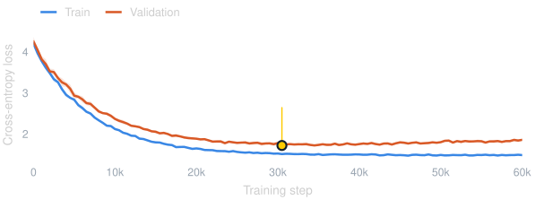{.lib-static fig-alt="Training and validation loss curves with shaded bands, drawn by matplotlib"}
:::

:::

::: {.notes}
All three draw the same numbers from `assets/compare/data.js`, written by `tools/compare_charts.py` together with the matplotlib SVGs. The deck's colours and font sizes are applied in each library: `Deck.layout()` for Plotly, `Deck.echarts()` for ECharts, `rcParams` for matplotlib.

The Python-Plotly panel is built with `plotly.graph_objects` in `tools/compare_charts.py` and exported with `fig.to_json()`: the same JSON a `{python}` cell embeds when Quarto runs it through Jupyter. plotly.py 7.1 bundles plotly.js 4.1.1 and this deck vendors 4.1.2, so both Plotly panels are drawn by the same engine and look the same. The difference is the workflow: Python and pandas for the data, but Python and Jupyter are needed wherever the deck is rendered, CI included (this deck avoids that by exporting the JSON once).
:::

## Libraries Compared: Bars with Error Bars {#compare-bars}

[Error bars are built into Plotly and matplotlib; ECharts draws them with a custom series.]{.lead}

::: {.lib-compare}

::: {.lib-col}
[Plotly from JavaScript]{.lib-name} [`error_y` · built in]{.lib-meta}

```{=html}
<div id="cmp-bars-plotly" class="lib-chart"></div>
<script>
Deck.chart("cmp-bars-plotly", (el) => {
  const c = Deck.colors, d = CompareData.bars;
  const traces = d.models.map((m, k) => ({
    type: "bar", name: m.name, x: d.benchmarks, y: m.y, marker: { color: c.series[k] },
    error_y: { type: "data", array: m.e, color: "rgba(255,255,255,0.6)", thickness: 2, width: 5 },
    hovertemplate: "<b>%{y:.1f}%</b> ± %{error_y.array:.1f}<extra>" + m.name + "</extra>",
  }));
  Plotly.newPlot(el, traces, Deck.layout({
    font: { size: 18 }, barmode: "group", bargap: 0.22, bargroupgap: 0.08, barcornerradius: 4,
    hoverlabel: { font: { size: 18 } }, margin: { l: 10, r: 10, t: 10, b: 10 },
    legend: { font: { size: 18 } },
    xaxis: { tickfont: { size: 17, color: c.body }, showgrid: false },
    yaxis: { title: { text: "Accuracy (%)", font: { size: 19 } }, tickfont: { size: 17 }, range: [0, 100] },
  }), Deck.config);
});
</script>
```
:::

::: {.lib-col}
[Plotly from Python]{.lib-name} [`error_y` · same as JavaScript]{.lib-meta}

```{=html}
<div id="cmp-bars-python" class="lib-chart"></div>
<script>
// Figure JSON exported from Python (tools/compare_charts.py), as a {python} cell would embed it
Deck.chart("cmp-bars-python", (el) => {
  const fig = CompareData.python.bars;
  Plotly.newPlot(el, fig.data, fig.layout, Deck.config);
});
</script>
```
:::

::: {.lib-col}
[Apache ECharts]{.lib-name} [`custom` series · ~20 lines]{.lib-meta}

```{=html}
<div id="cmp-bars-echarts" class="lib-chart"></div>
<script>
Deck.chart("cmp-bars-echarts", (el) => {
  const c = Deck.colors, d = CompareData.bars, n = d.models.length;
  const CAT_GAP = 0.22, BAR_GAP = 0.08;
  // Error bars: a custom series per model, offset to sit on its bar in the group
  const whisker = (k) => (params, api) => {
    const j = api.value(0), lo = api.coord([j, api.value(1) - api.value(2)]), hi = api.coord([j, api.value(1) + api.value(2)]);
    const band = api.size([1, 0])[0], bar = (band * (1 - CAT_GAP)) / (n + (n - 1) * BAR_GAP);
    const x = lo[0] - (band * (1 - CAT_GAP)) / 2 + k * bar * (1 + BAR_GAP) + bar / 2;
    const style = { stroke: "rgba(255,255,255,0.6)", lineWidth: 2 };
    return { type: "group", children: [
      { type: "line", shape: { x1: x, y1: lo[1], x2: x, y2: hi[1] }, style },
      { type: "line", shape: { x1: x - 5, y1: lo[1], x2: x + 5, y2: lo[1] }, style },
      { type: "line", shape: { x1: x - 5, y1: hi[1], x2: x + 5, y2: hi[1] }, style },
    ] };
  };
  const series = d.models.flatMap((m, k) => [
    { type: "bar", name: m.name, data: m.y, barGap: BAR_GAP * 100 + "%", barCategoryGap: CAT_GAP * 100 + "%",
      itemStyle: { color: c.series[k], borderRadius: [4, 4, 0, 0] } },
    { type: "custom", renderItem: whisker(k), data: m.y.map((y, j) => [j, y, m.e[j]]), silent: true, z: 3,
      tooltip: { show: false } },
  ]);
  Deck.echarts(el, {
    grid: { left: 70, right: 10, top: 44, bottom: 30 },
    legend: { left: 0, top: 0, data: d.models.map((m) => m.name) },
    tooltip: { trigger: "item", formatter: (p) => `${p.seriesName}<br><b>${p.value.toFixed(1)}%</b> ± ${d.models[p.seriesIndex / 2].e[p.dataIndex].toFixed(1)}` },
    xAxis: { type: "category", data: d.benchmarks, axisLabel: { color: c.body } },
    yAxis: { type: "value", min: 0, max: 100, name: "Accuracy (%)", nameLocation: "middle", nameGap: 48 },
    series,
  });
});
</script>
```
:::

::: {.lib-col}
[matplotlib]{.lib-name} [`yerr=` · built in · static SVG · 17 kB]{.lib-meta}

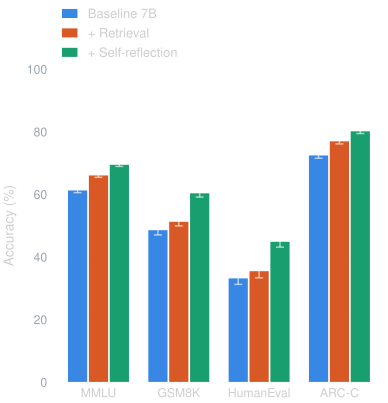{.lib-static fig-alt="Grouped bar chart of four benchmarks for three models with error bars, drawn by matplotlib"}
:::

:::

::: {.notes}
Plotly: `error_y` on each bar trace. matplotlib: `yerr=` on `ax.bar`. ECharts has no error bars, so each model gets a `custom` series whose `renderItem` draws the whisker and computes where its bar sits inside the group.

Rough guide: Plotly covers the most scientific chart types out of the box (error bars, violins, ECDFs, 3D, parallel coordinates). ECharts animates more smoothly and is a quarter of the size, but needs custom code for those. matplotlib gives print-ready static figures with no JavaScript, at the cost of hover, zoom and reflow.
:::

# [05]{.section-num} Showing model outputs {#outputs}

[Conversations, token attributions and qualitative results: show what the model actually does.]{.section-desc}

## LLM Conversation

::: {.chat}
::: {.msg .user who="User"}
I take 20 mg atorvastatin daily. My doctor just prescribed clarithromycin for a chest infection. Anything I should know?
:::
:::

::: {.grid2 .chat .mt-1}

::: {.msg .bot .fragment .typewriter who="Baseline 7B" fragment-index="0"}
No major concerns. Both medicines are commonly prescribed and can be taken together. Take clarithromycin with food to avoid stomach upset, and finish the full course.

[✗ Misses the drug interaction]{.verdict .bad .fragment fragment-index="2"}
:::

::: {.msg .bot .ours .fragment .typewriter who="+ Self-reflection (ours)" fragment-index="1"}
Yes, check with your doctor first. Clarithromycin blocks CYP3A4, the enzyme that clears atorvastatin, so statin levels can rise and with them the risk of muscle damage. Doctors often pause the statin for the course or choose another antibiotic.

[✓ Flags the CYP3A4 interaction]{.verdict .good .fragment fragment-index="2"}
:::

:::

::: aside
Illustrative example, not medical advice.
:::

::: {.notes}
Each reply is a fragment with `.typewriter`: it types itself out when revealed. Fragments inside it (the verdicts) are left alone and appear on a later click.
:::

## Token Attribution

::: {.lead}
Which input tokens drove the prediction? Click to reveal the attribution, then hover a token for its score.
:::

```{=html}
<div id="tokens-drug" class="tokens"></div>
<script>
Deck.steps("tokens-drug", {
  init(el) {
    Deck.tokens(el, [
      ["Patient", 0.08], [" was", 0.02], [" prescribed", 0.31], [" 20", 0.06], [" mg", 0.12], [" of", 0.01],
      [" ator", 0.92], ["vast", 0.85], ["atin", 1.0], [" to", 0.03], [" lower", 0.38], [" LDL", 0.66],
      [" cholesterol", 0.74], [".", 0.01], [" Which", 0.05], [" drug", 0.41], [" class", 0.47], [" does", 0.02],
      [" it", 0.14], [" belong", 0.09], [" to", 0.03], ["?", 0.02],
    ]);
  },
  step(el, i) { el.classList.toggle("lit", i >= 0); },
});
</script>
```

::: {.grid2 .mt-1 style="align-items: end;"}

::: {.card .stat .fragment}
[Prediction]{.label}
[Statin [p = 0.94]{.unit}]{.value style="font-size: 2.2em;"}
:::

::: {}
::: {.scale-legend}
[low]{.muted} []{.scale-bar} [high attribution]{.muted}
:::

::: {.lead .small}
Integrated gradients over a 7B model · subword tokens shown as the model sees them · synthetic scores
:::
:::

:::

::: {.notes}
`Deck.tokens(el, [[token, score], ...])` builds the highlighted text; scores are 0–1. Leading spaces mark word starts, so `" ator", "vast", "atin"` render as one word split into three tokens.
:::

## Qualitative Results

::: {.grid-2-1 style="grid-template-columns: 2.3fr 1fr; align-items: center;"}

::: {.qual-grid}
[Input]{.qual-head} [Baseline]{.qual-head} [Ours]{.qual-head .hl} [Ground truth]{.qual-head}
[]{.tile}
[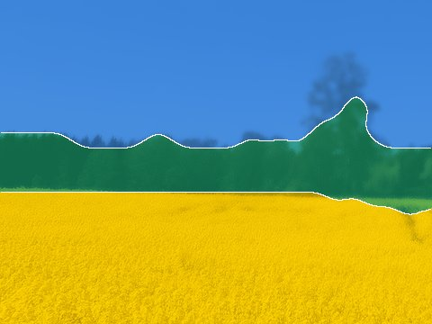]{.tile score="93.4"}
[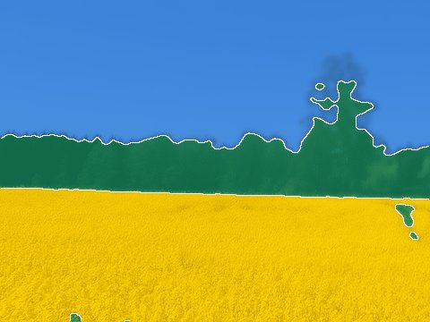]{.tile score="98.1"}
[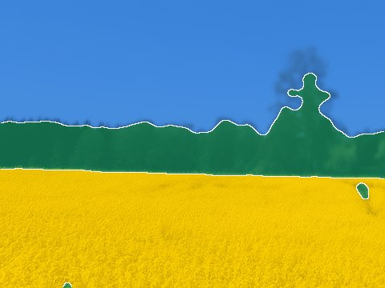]{.tile}
[]{.tile}
[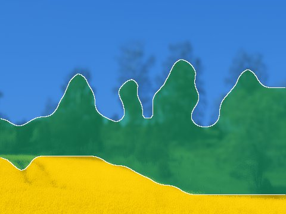]{.tile score="93.5"}
[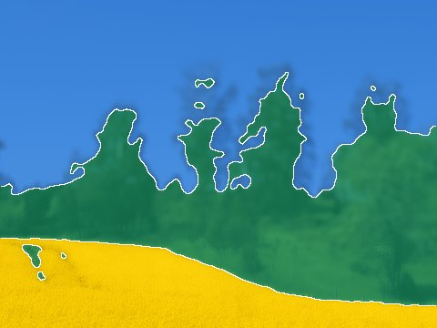]{.tile score="97.8"}
[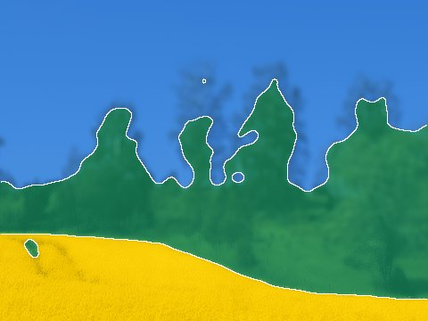]{.tile}
[]{.tile}
[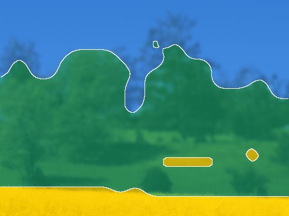]{.tile score="90.7"}
[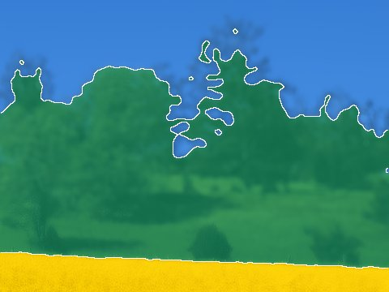]{.tile score="98.1"}
[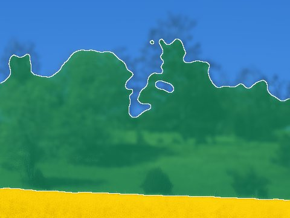]{.tile}
:::

::: {}
[Held-out images]{.kicker}

Badges show mIoU (%) against the ground truth. Hover a tile to zoom in.

::: {.legend .mt-1 style="flex-direction: column; gap: 18px; font-size: 0.7em;"}
[Sky]{style="--c: #3987e5"}
[Vegetation]{style="--c: #199e70"}
[Crop field]{style="--c: #FECB00"}
:::

::: {.takeaway .small}
The baseline's coarse masks lose thin structures such as tree crowns.
:::
:::

:::

# [06]{.section-num} Presenting {#presenting}

[Speaker view, live annotation, credits and a closing slide to hand out the deck.]{.section-desc}

## Presenter Toolkit

::: {.grid2 .mt-1 style="gap: 26px 60px; font-size: 0.75em;"}
<div><kbd>S</kbd> &nbsp; Speaker view: notes, timer, next slide</div>
<div><kbd>O</kbd> &nbsp; Overview of all slides</div>
<div><kbd>B</kbd> &nbsp; Whiteboard for sketching</div>
<div><kbd>C</kbd> &nbsp; Draw directly on the slide</div>
<div><kbd>F</kbd> &nbsp; Fullscreen</div>
<div><kbd>M</kbd> &nbsp; Slide menu & tools</div>
<div><kbd>E</kbd> &nbsp; Print / PDF export mode</div>
<div><kbd>Alt</kbd> + click &nbsp; Zoom into any detail</div>
:::

::: {.takeaway .mt-2}
Try it now: press <kbd>C</kbd>, draw on this slide, then press <kbd>C</kbd> again. Drawings stay on their slide.
:::

::: {.notes}
Whiteboard and drawing come from the chalkboard plugin, which is turned off in the standalone (single-file) build.
:::

## Credits Slide

::: {.grid2 .mt-1 style="gap: 4%;"}

::: {.card .people style="border-top-color: var(--accent); padding: 30px; font-size: 1em;"}
[AI Sweden]{.people-title .hl}

[**Elara Vance** [Data Alchemist]{.role}]{.person style="display: block;"}
[**Julian Thorne** [MLOps Whisperer]{.role}]{.person style="display: block;"}
[**Maya Lin** [Tensor Wrangler]{.role}]{.person style="display: block;"}
[**Silas Sterling** [LLM Architect]{.role}]{.person style="display: block;"}
[**Clara Rossi** [Semantic Engineer]{.role}]{.person style="display: block;"}
[**Henrik Berg** [Neural Navigator]{.role}]{.person style="display: block;"}
[**Sofia Chen** [Chief Model Orchestrator]{.role}]{.person style="display: block;"}
[**Marcus Reed** [Initiative Commander]{.role}]{.person style="display: block;"}
[**Elena Rostova** [Operations Synthesizer]{.role}]{.person style="display: block;"}
:::

::: {}
::: {.card .people style="border-top-color: var(--blue); padding: 30px; font-size: 1em;"}
[Project Partner]{.people-title style="color: var(--blue);"}

[**Felix Carter** [Compute Pioneer]{.role}]{.person style="display: block;"}
[**Kaelen Voss** [Lead Inference Architect]{.role}]{.person style="display: block;"}
:::

::: {.center style="margin-top: 150px;"}
[Project Co-funded by]{.kicker style="color: #aaaaaa; display: block; margin-bottom: 15px;"}

\<Financeer logo\>
:::
:::

:::

## {#thanks .closing background-image="assets/closing-bg.jpg" background-opacity="0.2" data-state="hide-ui"}

::: {.grid-2-1 style="grid-template-columns: 1.6fr 1fr; align-items: center; height: 100%;"}

::: {}
[Thank you]{.thanks}

[Questions & discussion]{.thanks-sub}

::: {.contact}
[Email]{.kicker} name.surname@ai.se

[Web]{.kicker} [ai.se](https://www.ai.se)

[Code]{.kicker} [github.com/aidotse](https://github.com/aidotse)
:::
:::

::: {.qr-card}
```{=html}
<div class="qr" data-fallback="https://aidotse.github.io/quarto-pres/"></div>
```
[Scan for the slides]{.qr-label}
[]{.qr-url}
:::

:::

::: {.notes}
The QR code is generated in the browser from the deck's own URL, so it always points to wherever the slides are hosted. Opened from a local file it uses `data-fallback`; set `data-url` to force a specific link.
:::

# [A]{.section-num} Appendix {#appendix visibility="uncounted"}

[Backup slides and references. Marked `visibility="uncounted"`, so they don't change the slide count shown during the talk.]{.section-desc}

## Backup: Training Setup {visibility="uncounted"}

::: {.lead}
Kept for questions; skipped in the main flow.
:::

::: {.compact-table .mt-1}
| Setting | Value | Setting | Value |
| :--- | :--- | :--- | :--- |
| Optimizer | AdamW (β = 0.9, 0.95) | Hardware | 8 × H100 80 GB |
| Learning rate | 3 × 10⁻⁴, cosine decay | Precision | bf16 mixed |
| Warm-up | 800 steps | Training tokens | 50 B |
| Batch size | 256 sequences × 4k tokens | Wall-clock | 6.5 days |
| Dropout / weight decay | 0.1 / 0.05 | Seeds | 5 |
:::

## References {visibility="uncounted"}

::: {#refs}
:::

## Hidden Slide {visibility="hidden"}

This slide stays in the source but is never shown: handy for drafts, or for slides only some audiences should see.
